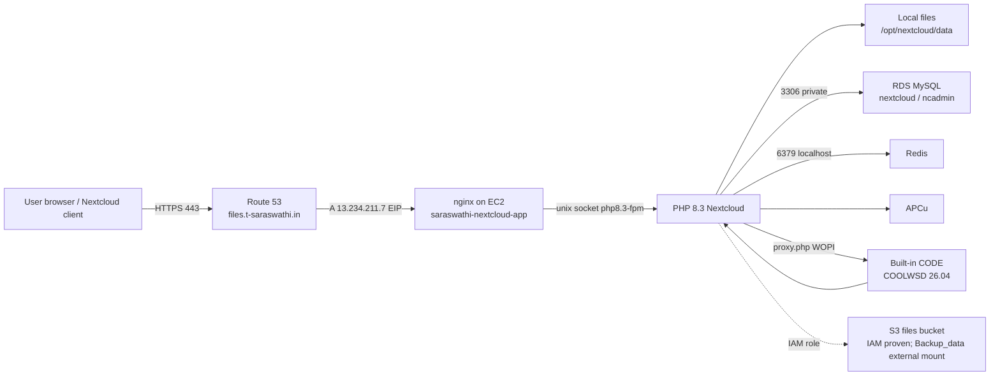
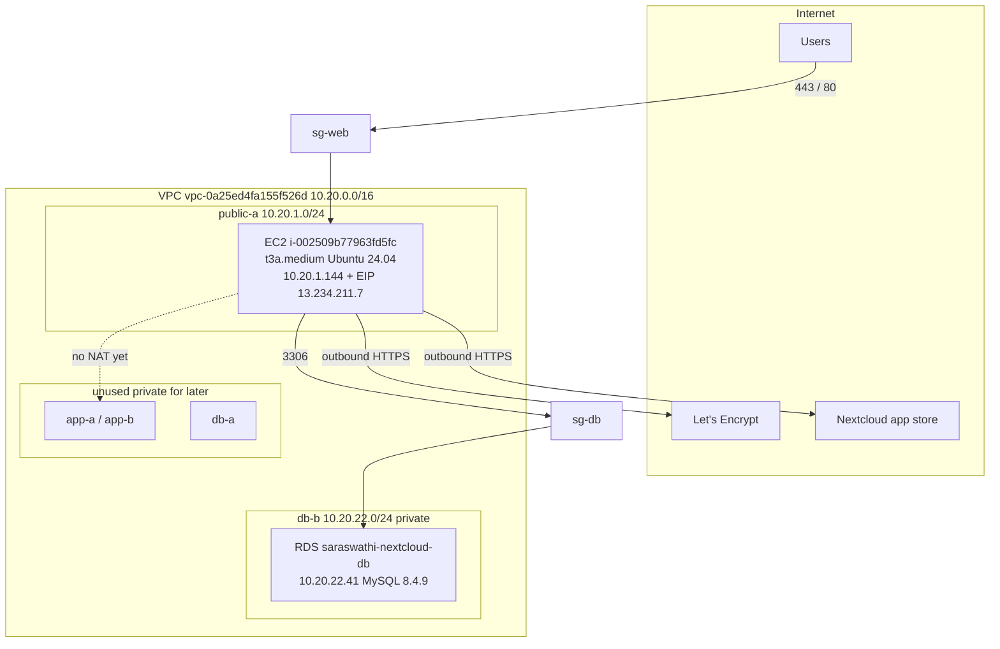
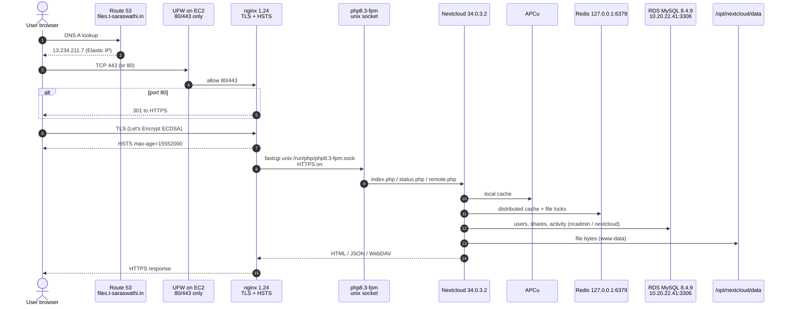
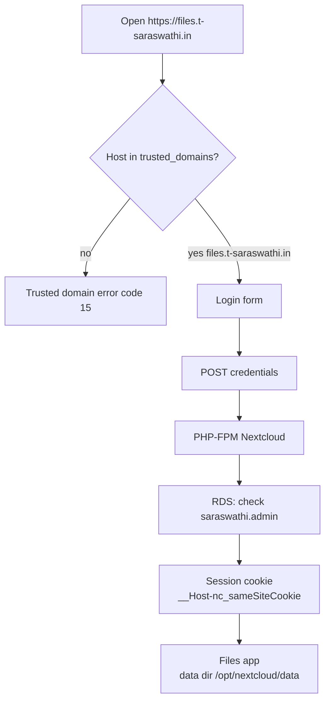
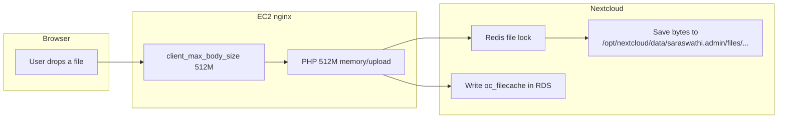
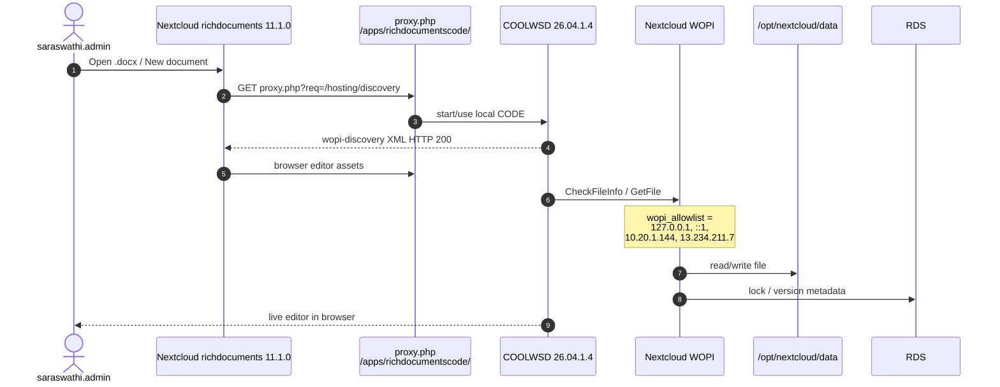
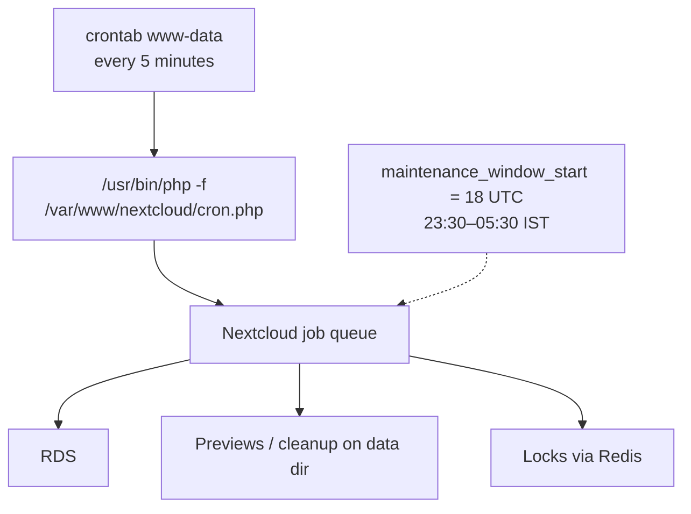
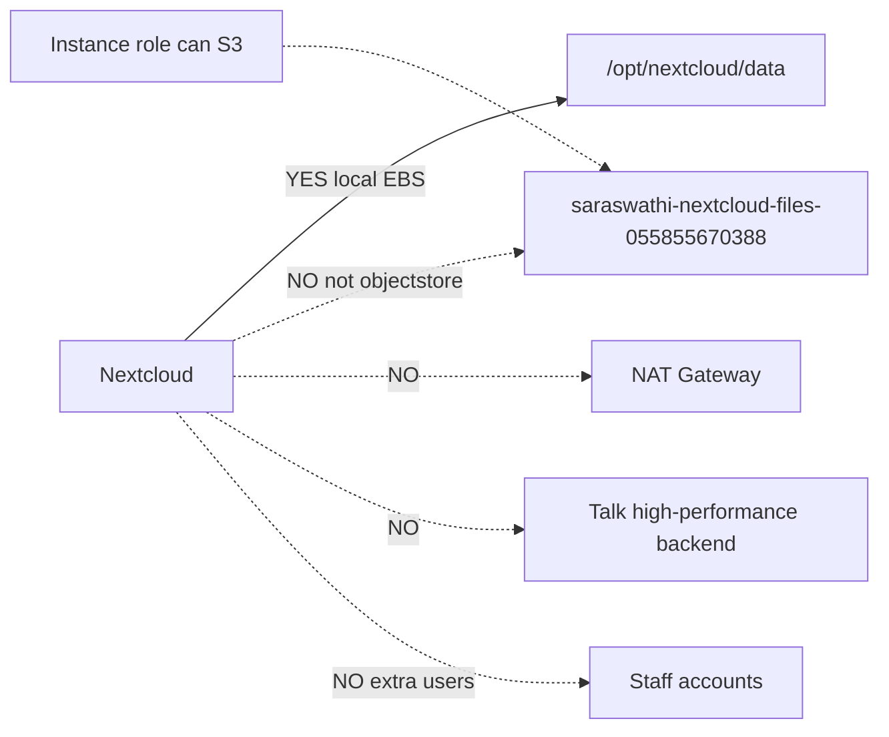

# Saraswathi Nextcloud — Technical Snapshot and Flow

**As of:** 2026-11-02 (cost optimisation: EC2 **t3a.medium**, Elastic IP **13.234.211.7**, 1-yr Savings Plan + RDS RI — see [SESSION_2026-11-02_COST_OPTIMISATION.md](../10-change-log/SESSION_2026-11-02_COST_OPTIMISATION.md)). Earlier: 2026-09-12 (CloudTrail data events off; rclone DATA1 complete). Snapshot body still 2026-08-26 unless a row below is dated later.  
**Operator:** Logesh P S (`logesh.implementer`)  
**Account:** 055855670388 (Saraswathi)  
**Region:** ap-south-1 (Mumbai)  
**Live URL:** https://files.t-saraswathi.in  

This file is the single technical picture of **what exists now**, **how a request flows**, and **what is still later**.  
Do **not** put passwords, `config.php`, private keys, or MFA codes here.

---

## 1. What this system is

Firm-owned **Nextcloud Hub 26 Spring (34.0.3)** on AWS Mumbai.

| Layer | Choice |
|---|---|
| Users (browser / mobile) | HTTPS to `files.t-saraswathi.in` |
| DNS | Route 53 hosted zone `t-saraswathi.in` |
| Web | nginx 1.24 + PHP-FPM 8.3 on one EC2 |
| App | Nextcloud 34.0.3.2 in `/var/www/nextcloud` |
| Files today | Local disk `/opt/nextcloud/data` (30 GiB). Bulk 132 GB = S3 folder **Backup_data** (external), not primary objectstore, not grown EBS |
| Metadata | Private RDS MySQL 8.4.9 |
| Cache / locking | APCu local + Redis localhost |
| Office | Built-in Collabora CODE on the same EC2 |
| Admin access to the OS | AWS SSM only (no SSH port 22) |

---

## 2. How it works (request flow)



### What happens on one page load

1. Browser asks DNS for `files.t-saraswathi.in`.
2. Route 53 returns the EC2 **Elastic IP** `13.234.211.7` (since 2026-11-02; fixed across stop/start. Old auto-assigned `3.111.213.217` was released).
3. TLS terminates on nginx (Let’s Encrypt ECDSA). HTTP 80 redirects to HTTPS. HSTS is set.
4. nginx passes PHP to `unix:/run/php/php8.3-fpm.sock`.
5. Nextcloud reads/writes:
   - **file bytes** → `/opt/nextcloud/data` (www-data)
   - **users, shares, metadata** → RDS (private subnet, SG from app only)
   - **cache + file locks** → Redis `127.0.0.1:6379` and APCu
6. Opening a Word/Excel file: Nextcloud Office talks to built-in CODE via  
   `https://files.t-saraswathi.in/apps/richdocumentscode/proxy.php?req=/hosting/discovery`
7. Every 5 minutes `www-data` runs `/usr/bin/php -f /var/www/nextcloud/cron.php`.
8. You never SSH. Session Manager uses the instance IAM role `saraswathi-ec2-ssm`.

### Network / security flow



Security groups:

- **sg-web** — inbound 80/443 from the internet  
- **sg-app** — inbound 80 from sg-web (present; Nextcloud currently listens on the same host)  
- **sg-db** — inbound 3306 from sg-app only  
- **sg-admin** — no inbound  
- **UFW** on the host — deny incoming except 80/443; **no 22**  
- **Redis** — localhost only  
- **RDS** — not public  
- **S3** — block all public access  

---

## 2b. Detailed live flow (how it works *right now*)

This is the **current** production path only. S3 is **not** on the file path. There is **no** NAT, **no** Talk HPB, **no** extra users. Public entry is the Elastic IP `13.234.211.7` (since 2026-11-02).

### A. One HTTPS request, step by step



### B. Login (only `saraswathi.admin` exists)



### C. File upload / download (local disk, not S3)



S3 bucket exists and the instance **can** Put/Get via IAM, but Nextcloud **does not** send user files there yet.

### D. Open / edit an Office file (built-in CODE)



Custom `wopi_url` is **empty**. Built-in CODE is reached only through `proxy.php?req=...`.

### E. Background jobs (cron)



### F. How *you* manage the server (no SSH)

```mermaid
flowchart LR
  YOU[logesh.implementer + MFA] --> AWS[AWS Console Mumbai]
  AWS --> SSM[EC2 Connect → Session Manager]
  SSM --> EC2[i-002509b77963fd5fc]
  EC2 --> OCC["sudo -u www-data php occ ..."]
  EC2 --> NGINX[/etc/nginx/sites-enabled/files.t-saraswathi.in]
  YOU --> R53[Route 53: files A record only]
  YOU --> IAM[Role saraswathi-ec2-ssm]
```

Port **22 is closed**. Do not use PuTTY or VS Code Remote SSH.

### G. What is *not* on the live file path



---

## 3. Confirmed inventory (no secrets)

### Account / identity

| Item | Value |
|---|---|
| AWS account | 055855670388 |
| Implementer | IAM `logesh.implementer` + MFA (not root from home) |
| EC2 IAM role | `saraswathi-ec2-ssm` (AmazonSSMManagedInstanceCore + inline `saraswathi-nextcloud-s3`) |
| Tags | Project=Nextcloud, Owner=Saraswathi, Environment=Production |
| CloudTrail | `Saraswathi-management-trail` Logging; validation **Enabled**; S3 **data events not configured** (off 2026-09-12 after ingest); management events All; log bucket `aws-cloudtrail-logs-055855670388-1f1c3ed9` |
| VPC flow logs | fl-0bb98d0c00ed6bd8b → `/vpc/saraswathi-nextcloud-vpc` |

### Domain / TLS

| Item | Value |
|---|---|
| Domain | `t-saraswathi.in` (Route 53 register; auto-renew; transfer lock) |
| Service name | `files.t-saraswathi.in` A → `13.234.211.7` (Elastic IP) TTL 300 |
| Change ID | C10319213ESNLUUVEI11Q (2026-11-02, moved to EIP); original C09702172G2CLD1D4TXOC (2026-08-25, `3.111.213.217`) |
| Certificate | Let’s Encrypt ECDSA; expires **2026-11-22**; auto-renew |
| Paths | `/etc/letsencrypt/live/files.t-saraswathi.in/` (never paste privkey) |
| Do not | change NS, delete, transfer, or unlock the domain |

### VPC

| Item | Value |
|---|---|
| VPC | vpc-0a25ed4fa155f526d `saraswathi-nextcloud-vpc` 10.20.0.0/16 |
| IGW | igw-02ac3964b2f226ce1 |
| Public RT | rtb-0f47bead49020f30c — 0.0.0.0/0 → IGW; public-a + public-b |
| App RT | rtb-0053cd2e7800f4558 — local only |
| DB RT | rtb-0d28b44ae54b4b1af — local only |
| public-a | subnet-0032deb58f3f4911d 10.20.1.0/24 ap-south-1a **(EC2 lives here)** |
| public-b | subnet-00f025cdbb7e55063 10.20.2.0/24 ap-south-1b |
| app-a | subnet-046e174df1d34b966 10.20.11.0/24 |
| app-b | subnet-05bb5715e314ee9a0 10.20.12.0/24 |
| db-a | subnet-0e11d25441d4a8b85 10.20.21.0/24 |
| db-b | subnet-0f590566d5279bdb3 10.20.22.0/24 **(RDS lives here)** |

### Compute

| Item | Value |
|---|---|
| Instance | i-002509b77963fd5fc `saraswathi-nextcloud-app` |
| Type | **t3a.medium** (2 vCPU AMD EPYC, 3.7 GiB RAM) since 2026-11-02; was t3.medium |
| Billing | 1-yr **EC2 Instance Savings Plan** t3a ap-south-1, No Upfront, $0.0155/hr, `358b5613-3e8e-4db9-b9b5-92acf54ea648`, 2026-11-02 → 2027-11-02 |
| AMI / OS | ami-006f82a1d5a27da54 Ubuntu **24.04.4 LTS** kernel 7.0.0-1011-aws |
| Private IP | 10.20.1.144 |
| Public IPv4 | **13.234.211.7** — Elastic IP `eipalloc-0cb0b191a0994190f` (`saraswathi-nextcloud-eip`), association `eipassoc-0e5928a0172ddb2eb`, since 2026-11-02. Old auto-assigned `3.111.213.217` released |
| Disk | vol-0063c19bdcb7583bf 30 GiB gp3 encrypted `saraswathi-ebs` |
| Key pair | none |
| Termination protection | on |
| IMDSv2 | required |
| SGs | web + app + admin |

### Database

| Item | Value |
|---|---|
| Identifier | saraswathi-nextcloud-db |
| Endpoint | `saraswathi-nextcloud-db.c5giuu4c6ye6.ap-south-1.rds.amazonaws.com:3306` |
| Private IP | 10.20.22.41 |
| Engine | MySQL **8.4.9** Community, db.t4g.micro |
| Billing | 1-yr **RDS Reserved Instance** `saraswathi-nextcloud-db-ri-1yr`, db.t4g.micro MySQL Single-AZ, No Upfront, $0.017/hr, from 2026-11-02 |
| AZ | ap-south-1b |
| DB name / user | `nextcloud` / `ncadmin` (password in password manager only) |
| Storage | gp3 20 GiB, autoscaling max 50 GiB |
| Encryption | KMS `saraswathi-rds` |
| Public | no |
| Multi-AZ | no |
| Deletion protection | on |

### S3 / KMS

| Item | Value |
|---|---|
| Files bucket | `saraswathi-nextcloud-files-055855670388` ap-south-1 |
| Public access | Block all ON; ACLs disabled; versioning ON; SSE-S3 |
| IAM probe | 2026-08-25 `S3_PROBE_OK` via instance role (no access keys) |
| Nextcloud objectstore | **not** configured — files still local |
| KMS EBS | c7e84359-7794-41ea-bd5c-5f77ccf75875 rotation 365d |
| KMS RDS | 81793ce0-4ca7-4805-8098-17a51d3b0f31 rotation 365d |

### Nextcloud / OS stack

| Item | Value |
|---|---|
| App dir | `/var/www/nextcloud` www-data |
| Data dir | `/opt/nextcloud/data` www-data |
| Version | 34.0.3 / internal **34.0.3.2** |
| Admin user | `saraswathi.admin` (not the RDS user) |
| trusted_domains | `files.t-saraswathi.in` |
| overwrite.cli.url | `https://files.t-saraswathi.in` |
| overwriteprotocol | https |
| Phone region | IN |
| Timezone | Asia/Kolkata |
| PHP | 8.3.6 NTS; memory/upload 512M; output_buffering Off |
| nginx | 1.24.0; site `/etc/nginx/sites-enabled/files.t-saraswathi.in` |
| PHP-FPM | unix `/run/php/php8.3-fpm.sock` |
| Redis | 7.0.15; 127.0.0.1:6379 PONG |
| memcache.local | `\OC\Memcache\APCu` |
| memcache.distributed / locking | `\OC\Memcache\Redis` |
| Cron | `*/5 * * * *` www-data `php -f /var/www/nextcloud/cron.php` |
| maintenance_window_start | 18 UTC (23:30–05:30 IST) |
| HSTS | `max-age=15552000; includeSubDomains` |
| fail2ban | 1.0.2 |
| AWS CLI | 2.36.30 `/usr/local/bin/aws` |
| Hard pin | PHP **8.3** (not 8.5); Ubuntu **24.04** (not 26.04) |

### Office

| Item | Value |
|---|---|
| Apps | richdocuments **11.1.0**, richdocumentscode **26.4.104** |
| Engine | COOLWSD **26.04.1.4** (built-in CODE, no Docker, no second EC2) |
| Discovery | HTTP 200 XML at `.../proxy.php?req=/hosting/discovery` |
| Custom wopi_url | **deleted** (built-in autodetect) |
| allow_local_remote_servers | true |
| wopi_allowlist | 127.0.0.1, ::1, 10.20.1.144, 13.234.211.7 (updated 2026-11-02; old `3.111.213.217` removed) |

### Groupware

| Item | Value |
|---|---|
| calendar | 6.5.4 enabled |
| contacts | 8.7.6 enabled |
| tasks | 0.18.1 enabled |
| CalDAV / CardDAV | `/.well-known/caldav` and `carddav` → 301 `/remote.php/dav/` |
| Admin calendar | `personal` / Personal, writable, `saraswathi.admin` |
| Admin address book | `contacts` / Contacts, writable, `saraswathi.admin` |
| Shared firm calendar | not created (no extra users yet) |

### Deck

| Item | Value |
|---|---|
| deck | 1.18.3 enabled |
| `/apps/deck/` | 401 without login (present) |
| Sample board | not created yet |

### LibreSign

| Item | Value |
|---|---|
| libresign | 14.1.0 enabled |
| configure:check | all success |
| java / JSignPdf / PDFtk | OpenJDK 21.0.8 / 2.3.0 / 3.3.3 |
| poppler | 24.02.0 |
| openssl CA | internal `Saraswathi LibreSign CA` (not the website cert) |

### Time Manager

| Item | Value |
|---|---|
| timemanager | 0.3.25 enabled |
| `/apps/timemanager/` anonymous HEAD | HTTP 500 (guest TypeError; keep enabled) |
| Cause | `AppConfig::getUserValue()` null `$userId` in `PageController.php` line 135 |
| Sample clients / time entries | not created |

### Talk

| Item | Value |
|---|---|
| spreed | 24.0.4 enabled (shipped) |
| `/apps/spreed/` anonymous | HTTP 303 See Other |
| signaling_servers | not set (no HPB) |

### Backup

| Item | Value |
|---|---|
| RDS automated backups | Enabled, **7 days**, window 17:22–17:52 UTC; latest restore 2026-08-26 21:57 IST |
| RDS snapshots | `rds:saraswathi-nextcloud-db-2026-08-24-18-50`, `rds:saraswathi-nextcloud-db-2026-08-25-17-32` |
| EBS snapshot | `snap-0a1d21b760e5e6bf6` (Aug manual) **deleted 2026-11-02**. Pre-switch safety snapshot `snap-006094f30c8419f2a` (`saraswathi-pre-t3a-20261102`) — delete after ~1 week stable |
| AWS Backup vault / DLM | vault `saraswathi-backup-vault` tags Project/Owner/Environment; plan daily 12:30 IST 7d; on-demand **Completed** `snap-0877c1316d9702f73`; DLM none |
| Cost budget | `Saraswathi-Monthly-AWS-Budget` **$60**/mo (Healthy; $9.44 MTD 15.73%). Duplicate `_2` deleted |
| SNS | `saraswathi-ops-alerts` EMAIL **Confirmed** |
| CW alarms | five **OK** (status, CPU, RDS storage, mem, disk) |
| CloudWatch agent | **1.300071.0b1720 running** (mem + disk `/`); `CloudWatchAgentServerPolicy` on `saraswathi-ec2-ssm` |

---

## 4. What we did (in order)

```mermaid
flowchart TD
  A[Control folders + contract] --> B[IAM / domain t-saraswathi.in]
  B --> C[CloudTrail]
  C --> D[VPC + 6 subnets + IGW + RTs + flow logs]
  D --> E[SGs + KMS + empty S3]
  E --> F[RDS private MySQL]
  F --> G[EC2 Ubuntu 24.04 SSM no SSH]
  G --> H[Patch + nginx redis fail2ban UFW]
  H --> I[PHP 8.3 + RDS client proof]
  I --> J[Download + extract Nextcloud 34.0.3.2]
  J --> K[HTTP nginx + occ install]
  K --> L[DNS A + Let's Encrypt HTTPS]
  L --> M[Redis/APCu + system cron]
  M --> N[Health + HSTS + maintenance window]
  N --> O[S3 IAM probe]
  O --> P[Office built-in CODE]
  P --> Q[Groupware Calendar Contacts Tasks]
  Q --> R[Deck 1.18.3]
  R --> S[Groups Firm-*]
  S --> T[Admin Firm/ folder tree]
  T --> U[LibreSign tools OK]
  U --> V[Time Manager 0.3.25]
  V --> W[Talk spreed 24.0.4 no HPB]
  W --> X[RDS 7d backups + EBS snap created]
  X --> Y[EBS snap Completed]
  Y --> Z[Budget _2 deleted; one $60 remains]
  Z --> AA[CloudWatch default-metric alarms]
  AA --> AB[CloudWatch agent + mem/disk alarms]
  AB --> AC[AWS Backup vault + daily EBS plan]
  AC --> AD[On-demand EBS into firm vault Completed]
  AD --> AE[Nextcloud versions + trash enabled]
  AE --> AF[S3 versioning Enabled]
  AF --> AG[Activity 7.0.0]
  AG --> AH[admin_audit 1.24.0]
  AH --> AI[CloudTrail data events + validation]
  AI --> AJ[CloudTrail tags]
  AJ --> AK[Backup vault tags]
```



| When | Done |
|---|---|
| 24 Aug | Folders, CloudTrail, VPC, subnets, IGW, routes, flow logs, SGs, KMS, S3 bucket, domain registered |
| 25 Aug | RDS, EC2, OS patch, base packages, PHP 8.3, RDS path, Nextcloud extract + CLI install, HTTPS, Redis/cr; AWS Backup vault + on-demand Completedon, health, HSTS, S3 IAM, Office CODE, groupware apps |
| 26 Aug | Snapshot + flowcharts; LibreSign/Talk/Time Manager; RDS 7d + EBS snap; $60 budget; CW agent + 5 alarms |

---

## 5. Done vs later

**Live now**

- HTTPS Nextcloud 34.0.3.2 for `saraswathi.admin`
- Files on local EBS data dir
- RDS metadata
- Redis + cron + HSTS
- Built-in Office
- Deck 1.18.3 (no boards yet)
- Groups: Firm-Admins (saraswathi.admin), Firm-Partners, Firm-Seniors, Firm-Juniors, Firm-Trainees, Firm-Departed empty
- LibreSign 14.1.0 tools all success
- Talk `spreed` 24.0.4 (no HPB)
- RDS automated backups 7 days; EBS daily AWS Backup 7 days (Aug manual `snap-0a1d21b760e5e6bf6` deleted 2026-11-02)
- Elastic IP `13.234.211.7` on EC2 (2026-11-02)
- 1-yr EC2 Savings Plan (t3a) + 1-yr RDS Reserved Instance db.t4g.micro (2026-11-02)
- Monthly cost budget `Saraswathi-Monthly-AWS-Budget` **$60** (Healthy; $9.44 MTD)
- CloudWatch default + agent alarms — five **OK** (status/CPU/RDS/mem/disk)
- AWS Backup vault + daily EBS plan; on-demand Completed in `saraswathi-backup-vault`
- Nextcloud `files_versions` 1.27.0 + `files_trashbin` 1.24.0 enabled (retention `auto`)
- S3 files bucket versioning **Enabled**, SSE-S3 (empty; not objectstore)
- Activity **7.0.0** enabled
- `admin_audit` **1.24.0** enabled (default logfile)
- CloudTrail: Logging, log file validation **Enabled**; S3 data events **off** 2026-09-12 (detail: not configured); last log file 2026-09-12 09:32:45 IST
- AWS Backup vault `saraswathi-backup-vault`: lock none; 1 recovery point

- Nextcloud log: 8 errors leftover/known; LibreSign Sign jobs **0**
- Trash + versions restore proven on `_restore-drill.txt` (admin only)
- Activity events working; admin_audit enabled (default logfile unset)
- Budget $60 Healthy $9.44 MTD; RDS automated backups Enabled 7d (do not Apply pending OS)

- Phase 7 admin UAT G–K: folder depth, star/comment, Office new, ZIP, grid/list

- Phase 7 L–P: copy, preview, LibreSign UI, calendar event, Deck board

- Phase 7 Q–U: contact, task, Talk room+message, file tag, name search
- Phase 7 V–Z: xlsx, Save-as-PDF (Export PDF fail), Deck due/label/checklist, TM client, sort/activity

**Started, not closed**

- Phase 7 batch 5: **Done** (AH no track-changes)
- Storage: S3 folder **Backup_data** (runbooks 16–20). Objectstore skip. EBS grow cancelled.
- From-now plan: [FROM_NOW_TO_END_PLAN.md](FROM_NOW_TO_END_PLAN.md)
- Operator runbooks: [../04-from-now-runbooks/00_READ_ME_FIRST.md](../04-from-now-runbooks/00_READ_ME_FIRST.md) then [../04-from-now-runbooks/16_PLAN_S3_FOLDER_INDEX.md](../04-from-now-runbooks/16_PLAN_S3_FOLDER_INDEX.md)

Shared calendars, Deck boards, and Time Manager clients wait for extra users / browser login.

**Later (do not treat as live)**
objectstore (skipped; use External storage folder instead)
- Talk high-performance backend (HPB not installed)
- email SMTP
- Extra users / groups / sharing matrix
- 150 GB upload into **Backup_data** after M1S3 proof + M2 groups / sharing matrix
- 150 GB upload
- NAT Gateway, DLM (AWS Backup covers scheduled EBS). Elastic IP is **done** (2026-11-02)
- Collabora **Docker** / second EC2 (not used; built-in CODE instead)

**Hard stops still in force**

- No root from home  
- No port 22  
- No passwords in chat or git  
- No domain NS change / delete / transfer  
- No PHP 8.5  
- No NAT until required  
- No filling S3 with 150 GB yet  

---

## 6. Paths and commands operators actually use

| Task | Where |
|---|---|
| OS / occ | EC2 → Connect → **Session Manager** |
| App | `/var/www/nextcloud` |
| Data | `/opt/nextcloud/data` |
| nginx site | `/etc/nginx/sites-enabled/files.t-saraswathi.in` |
| Health JSON | `https://files.t-saraswathi.in/status.php` |
| occ | `sudo -u www-data php /var/www/nextcloud/occ ...` |

Step-by-step evidence lives under [03-aws-evidence/](../03-aws-evidence/). Changelog: [10-change-log/change-log.md](../10-change-log/change-log.md).

---

## 7. Known nits (not blockers)

| Item | Note |
|---|---|
| Public IP | **Elastic IP `13.234.211.7`** since 2026-11-02 — stays the same across stop/start. Do not release it (DNS A + `wopi_allowlist` depend on it). |
| nginx wasm warn | Duplicate `wasm` type vs Ubuntu `mime.types`. Harmless. |
| Talk HPB / Client Push / email / AppAPI daemon | Expected setupcheck leftovers |
| Imagick SVG | Optional |
| 2FA | TOTP app present; **not enforced** |
| `overwrite.cli.url` CLI hint `https://localhost` | Ignore; keep `https://files.t-saraswathi.in` |
| EC2 still in **public-a** | Required today because there is **no NAT** for a private app subnet |
