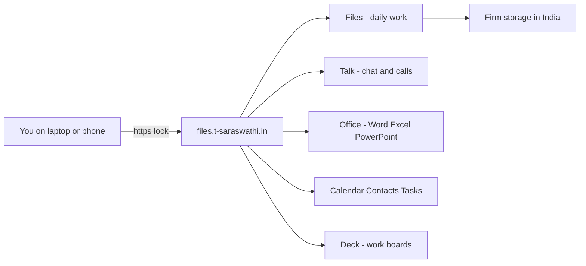
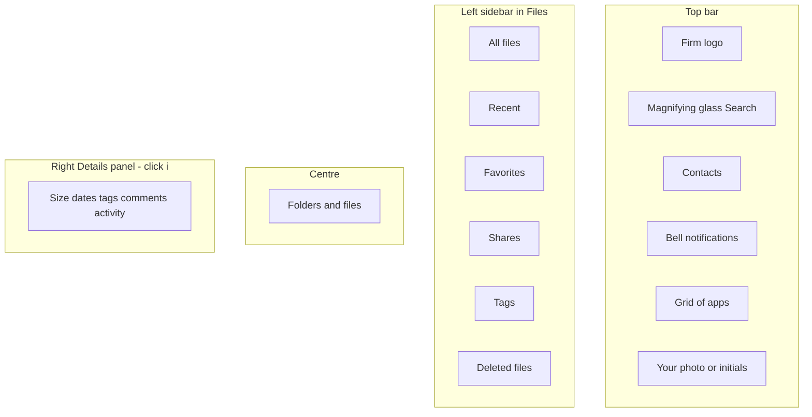
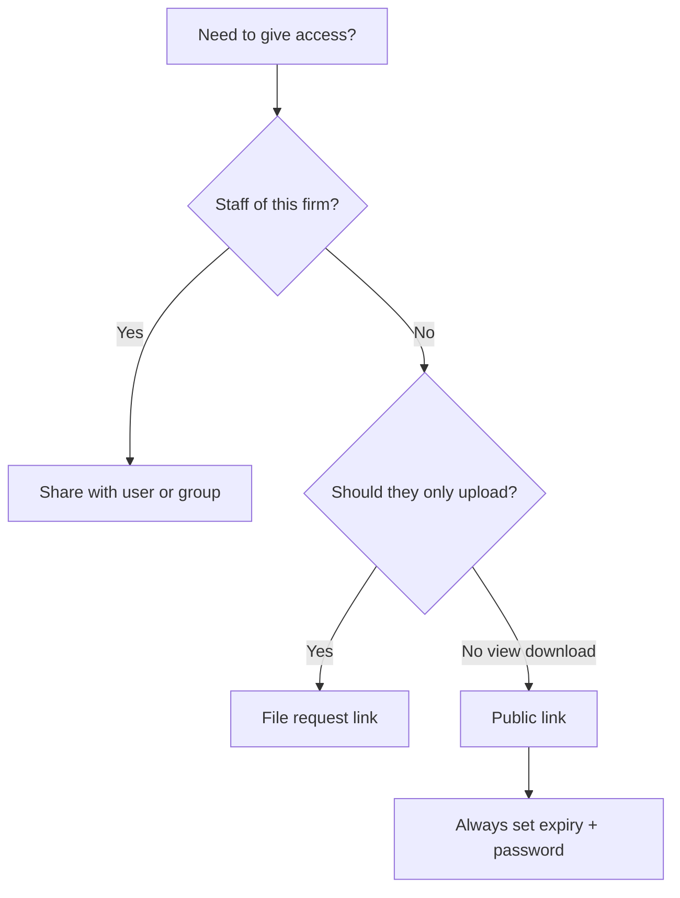

# Firm Cloud Files — Complete End-to-End User Manual

**Prepared for:** CS. T. Saraswathi & staff  
**System:** Secure Cloud Document Management (Nextcloud on AWS Mumbai)  
**Website:** https://files.t-saraswathi.in  
**Based on:** Feature Overview Document (August 2026) and Quotation LPS/2026/CDM/001  
**Audience:** Non-technical users. Search this file for a **feature name** or a **code** such as `A6` or `Share`.  
**Prepared by:** Logesh P S  

> **For the client pack, use [CLIENT_FEATURE_ENCYCLOPEDIA.md](CLIENT_FEATURE_ENCYCLOPEDIA.md)** — every code A1–P4 with what it is, configure/use steps, problems, and **ON / PARTIAL / NOT CONFIGURED** on this firm. This shorter file is only a first-day map.

---

## How to use this book

1. Press **Ctrl+F** (Find) and type what you want, for example `share with client`, `restore deleted`, `video call`, `A8`, `trash`.
2. Every feature has the same four parts:
   - **What it is** — in plain language  
   - **When to use it**  
   - **Exact clicks** — numbered, as you see them on screen  
   - **What “done” looks like**
3. Codes such as **A1**, **B5**, **C3** are the same codes as in the proposal. You can match this book to the quotation.
4. Pictures in this file are **screen maps** (diagrams). They show *where* to click. They are not photographs of your live portal.

---

## 0. What you were given (plain language)

Your firm now has a **private cloud drive**, similar to Google Drive or Dropbox, but:

- It is **yours** (the firm owns the AWS account).
- Files live in **India** (Mumbai).
- Up to **10 people** can log in (partners, seniors, juniors, trainees).
- You can use it from a **browser**, a **Windows/Mac folder**, or a **phone**.
- Sharing, office editing, chat, calendar, tasks, recycle bin, and activity history are built in.

**Day-to-day work** happens in **Files**.  
**Old bulk backup** of company folders lives under **Backup_data** (large archive). Treat that as a library, not a place to dump personal downloads.

---

## 1. First login (everyone)

### 1.1 Open the site

1. Open **Google Chrome** or **Microsoft Edge** (recommended).
2. In the address bar type exactly: `https://files.t-saraswathi.in`
3. Press Enter.
4. You must see a **padlock** next to the address. If you see “Not secure”, stop and tell the administrator.

### 1.2 Sign in

1. Username = the ID the administrator gave you (example: `partner1`).  
   It is **not** always your email.
2. Password = the one you were given, or the one you set.
3. Click **Log in**.
4. If a second screen asks for a code from your phone (**two-factor**), open your authenticator app, type the 6-digit code, continue.
5. First time: you may be asked to **change password**. Choose a long password you do not reuse elsewhere. Write it only in your password manager, never in WhatsApp.

**Done:** You see a home / dashboard and a left menu with **Files**.

### 1.3 If login fails

| What you see | What to do |
|---|---|
| Wrong password | Try Caps Lock. Then ask admin to reset. Do not keep guessing (the system slows attackers). |
| Site will not open | Check internet. Try another browser. Tell admin if everyone is locked out. |
| “Access through untrusted domain” | You typed a wrong address. Use only `https://files.t-saraswathi.in`. |

---

## 2. The screen — where everything lives

**Apps menu** (square of dots, top-right) opens: Files, Photos, Talk, Calendar, Contacts, Tasks, Deck, Office, LibreSign, Forms (if enabled), and **Personal settings**.

**Your avatar** (top-right circle) opens: Personal settings, Help, Log out.

You almost never need Amazon or “the server”. If a job needs an administrator, this book says **Admin only**.

---

## 3. Ten-minute daily path

1. Log in.
2. **Files** → open the client / year folder you need.
3. Click a PDF or Word file to **preview or edit**.
4. If you must send it outside the firm, use **Share** (Section C) — do not WhatsApp the original from an unknown copy.
5. When finished, **Log out** on a shared PC.

---

## 4. Where firm papers live

| Place | What it is | Who uses it |
|---|---|---|
| **Firm** | Partners, Administration, Clients, Statutory, Templates, Trainee workspace, Archive | Daily structured work |
| **Backup_data** | Large company-wise archive uploaded from office disks | Look-up of old MCA / KYC / year folders |
| **Your home** | Files only you uploaded unless you share them | Personal drafts — do not put the only copy of a client paper only here |

**Rules**

- Do **not** delete whole company folders in Backup_data “to clean up”.
- Do **not** rename company folders unless a partner asks.
- Prefer **year folders** already used (example `2023-24`) instead of inventing new spellings.

---

# Feature encyclopedia

Each heading is searchable. Codes match the proposal.

---

# A — Files and folders

## A1 Unlimited folder structure

**What it is:** Folders inside folders, as deep as you need (Client → Year → DIR-3 → Person).

**When:** New engagement, new year, new director KYC pack.

**Clicks**

1. **Files**.
2. Open the parent folder (or stay at the top).
3. Click **+** (top of the file list).
4. Click **New folder**.
5. Type a clear name. Avoid `final final 2`.
6. Enter.
7. Double-click the new folder to go inside. Repeat **+** → **New folder** for subfolders.

**Done:** Breadcrumb at the top shows `All files / Client / 2024-25 / …`.

---

## A2 Drag-and-drop upload

**What it is:** Pull files from your PC into the browser.

**When:** You have papers on the desktop or in Downloads.

**Clicks**

1. Open the **correct** destination folder first.
2. Resize the browser so you can see File Explorer and the portal.
3. Drag the file (or a folder) onto the centre of the Files page until a highlight appears.
4. Release the mouse.
5. Wait until the progress circle finishes.

**Done:** The name appears in the list. If it fails, use **+** → **Upload files** instead.

**Do not** drag the entire office disk (hundreds of GB) in the browser. That is an administrator / desktop-sync job.

---

## A3 Chunked uploads (large files)

**What it is:** A big file (even several GB) is sent in pieces so one network hiccup does not ruin the whole upload.

**When:** Large scanned PDFs, ZIP of a year, video.

**Clicks:** Same as A2 or **+** → **Upload files**. You do not turn this on; it is automatic.

**Done:** The file appears with the correct size (click the file → **Details**).

**Limit:** Extremely large single files (many GB) need a stable connection. If your office internet drops often, use the **desktop app** (G2).

---

## A4 Resume-on-failure

**What it is:** If Wi‑Fi dies mid-upload, the system continues from where it stopped instead of starting at 0%.

**When:** Large uploads on unstable internet.

**Clicks:** Start the upload as in A2. If it fails, **retry** the same file into the same folder. Do not create a second copy with `(1)` in the name unless you mean to.

**Done:** One file, full size, not a 0 KB stub.

---

## A5 Bulk download as ZIP

**What it is:** Download a whole folder as one compressed file.

**When:** You need a pack on a USB stick, or to give a partner a snapshot **you are allowed** to take.

**Clicks**

1. Open the parent of the folder (so you see the folder name in the list).
2. Tick the checkbox on the folder (or click the three dots **⋯** on that row).
3. Click **Download**.
4. The browser saves a `.zip`.
5. Open the zip on your PC with Extract All.

**Done:** Zip opens and shows the same inner folders.

**Caution:** Do not ZIP entire **Backup_data**. It is huge and can freeze the browser.

---

## A6 In-browser file preview

**What it is:** Open PDF, image, Office file **without** downloading.

**Clicks**

1. **Files** → find the file.
2. **Click the file name** (not the checkbox).
3. PDF/image: a viewer opens.  
   Word/Excel: Office editor may open (Section B).
4. Close with **X** or the browser back control.

**Done:** You can read the document on screen.

---

## A7 Thumbnails

**What it is:** Small pictures of images/videos in the folder.

**Clicks:** **Files** → open a folder of scans/photos. Switch to **grid** (A18) if you only see names.

**Done:** You see mini pictures, not only icons.

---

## A8 Full-text search

**What it is:** Find words **inside** PDFs and Office files, not only in the file name.

**Clicks**

1. Top bar: **magnifying glass**.
2. Type a unique word (DIN, company, person).
3. Press Enter.
4. Open a result.

**Done:** Matching files are listed.

**If nothing inside PDFs is found:** Filename search still works. Full-text needs the search indexer. Tell the administrator if inner-PDF search is empty for papers you know exist.

---

## A9 File tags

**What it is:** Coloured labels such as `Urgent`, `AF-24-25`.

**Clicks**

1. Click the file.
2. Open **Details** (sidebar **i** or **⋯** → **Details**).
3. **Tags** / **Collaborative tags**.
4. Type a tag name → Enter.
5. Later: left sidebar **Tags** to filter.

**Done:** Tag appears on the file and in the Tags view.

---

## A10 Favourites (star)

**What it is:** Pin a folder you open every day.

**Clicks**

1. On the row, click the **star**, or **⋯** → **Add to favorites**.
2. Left sidebar → **Favorites**.

**Done:** The folder is in Favorites.

---

## A11 Comments on files

**What it is:** A discussion stuck to the file (not inside Word).

**Clicks**

1. File → **Details**.
2. **Comments** tab.
3. Type (you can `@name` someone — N5).
4. Post.

**Done:** Comment is visible to people who can see the file.

---

## A12 File-level activity log

**What it is:** Who uploaded, renamed, shared this one file.

**Clicks:** File → **Details** → **Activity**.

**Done:** A time-ordered list of actions.

---

## A13 Metadata sidebar

**What it is:** Size, dates, owner, tags, comments, shares in one panel.

**Clicks:** Select file → **i** / **Details**.

**Done:** You see size and modified date (useful before you email “the latest”).

---

## A14 External storage mounts

**What it is:** Extra drives (S3 / WebDAV) attached by **admin**. **Backup_data** is this kind of place.

**You:** Open **Files** → **Backup_data**. Browse as a normal folder.

**You do not:** Connect Amazon yourself.

---

## A15 File locking

**What it is:** Mark “I am working on this — please do not overwrite.”

**Clicks**

1. **⋯** on the file → **Lock file** (if shown).
2. Unlock the same way when done.

**Done:** A lock icon.  
**Note:** Some office files can still *open* while locked. Treat the lock as a **team signal**. For true single-editor work, agree in Talk who owns the file.

---

## A16 Move / copy

**Clicks — Move**

1. **⋯** → **Move or copy**.
2. Browse to the destination.
3. **Move**.

**Clicks — Copy:** same, then **Copy**.

**Done:** File is in the new place (move) or in both places (copy).

---

## A17 Sort

**Clicks:** Top of the list: **Name**, **Size**, **Modified**. Click again to reverse.

**Done:** List reorders.

---

## A18 Grid or list view

**Clicks:** Icon at the top-right of the file list (squares vs lines).

**Done:** Photos look like a gallery (grid) or a table (list).

---

# B — Edit Word / Excel / PowerPoint in the browser

Open from **Files** by clicking a `.docx` / `.xlsx` / `.pptx`. A ribbon like Microsoft Office appears. **Close the tab** or use the editor close control when finished. Saving is usually automatic.

## B1 Edit Word (.docx)

1. Click the `.docx`.
2. Wait for the editor.
3. Type as in Word.
4. Close when done.

**Done:** Reopen — your text is there.

## B2 Edit Excel (.xlsx)

Same, with sheets, formulas, basic charts.

## B3 Edit PowerPoint (.pptx)

Same, slides in the left filmstrip.

## B4 Open Office formats (ODT / ODS / ODP)

Click the file. Editor opens. Save in the same format unless you **Save as** (B11).

## B5 Real-time co-authoring

1. Share the file with a colleague as **can edit** (C1).
2. Both open the **same** file.
3. Each types in a different paragraph.
4. You should see the other cursor or their text within a few seconds.

**Done:** Both names’ typing remain after refresh.  
If the second person is **read-only**, the share is View only — change to Edit.

## B6 Track changes

1. In the editor, look for **Review** → **Track Changes** (wording may be **Record changes**).
2. Type; marks appear.
3. Accept/Reject from Review.

**If there is no Track Changes:** use **Comments** (B7) and a copy of the file named `_reviewed`.

## B7 Comments inside the document

1. Select a paragraph or cell.
2. **Insert** → **Comment**.
3. Type. Colleague replies in the comment pane.

## B8 Export to PDF

1. In the editor: **File** → **Export as** / **Download as PDF** if present.  
2. If **Export PDF** errors, close the editor → in **Files**, **⋯** → **Convert** or download `.docx` and print to PDF on your PC.

## B9 Templates library

1. **Files** → **Templates** (under **Firm** if that is how the firm set it).
2. Copy a template (**⋯** → **Copy**) into the client folder.
3. Rename. **Never** type over the only master template.

## B10 Print

In the editor: **File** → **Print**, or Ctrl+P, choose the office printer.

## B11 Save as another format

**File** → **Save as** / **Download as** → pick DOCX, ODT, XLSX, etc.

## B12 Version history in the editor

**File** → **See version history** (or in Files: Details → **Versions**). Restore an older version if you overwrote by mistake.

## B13 Digital signatures on PDF (LibreSign)

1. Apps → **LibreSign** (or open a PDF → sign action if shown).
2. Choose the PDF.
3. Draw or upload a signature image, or follow certificate steps the admin set.
4. Save the signed PDF **as a new file** (`_signed`) so the unsigned original remains.

**Do not** practise on the only original of a client MCA form.

## B14 PDF form filling

Open the PDF. If fields are blue/interactive, click and type. Save. If the PDF is only a scan, you cannot “fill” it — use comments or a new Word cover.

---

# C — Sharing

**Think before you share.** Client papers leave the firm’s control when a public link exists.

## C1 Share with internal users

1. **⋯** on file/folder → **Share**.
2. Search the person’s name.
3. Choose **View** or **Edit**.
4. Close the panel.

**Done:** They see it under **Shares**.

## C2 Share with a group

Same as C1, type the **group** (example Firm-Partners).

## C3 Public shareable link

1. Share panel → **Share link** / **+** Create link.
2. Copy the URL. Send by email (not in a public WhatsApp group if it is confidential).

## C4 Link expiry

In the link settings: **Set expiration date**. Pick a date soon (example 7 days).

## C5 Link password

Link settings → **Password** → set a password. Send the password **in a different** channel (SMS vs email).

## C6 Disable download

Link settings → **Allow download** off (wording: Hide download). Recipient can view, not save.

## C7 Editable public link

Link settings → permission **Edit**. Only for a trusted auditor. Prefer C1 if they can have a user ID.

## C8 File-request (upload only)

1. Share → **File request** / **Allow upload and editing** without listing, depending on version.  
   Common path: create an empty folder → Share link → **File drop** / **Allow upload**.
2. Send only that link.
3. They can drop files; they should **not** see other client files.

## C9 Share notifications

When someone uses a share, a **bell** (and email if mail is configured) appears. Open the bell.

## C10 Instant revoke

Share panel → **…** on that person or link → **Unshare**. Access stops.

## C11 Federated sharing

Share using an address like `user@other-nextcloud.com`. **Only if** the other organisation also runs Nextcloud and the admin enabled this. Most firms will never use it.

## C12 Share summary

Left **Shares**, or avatar → **Sharing**. Lists what you shared. Revoke from there (C10).

---

# D — Talk (chat and calls)

Open **Talk** from the apps grid.

## D1 1-to-1 text chat

1. Talk → **+** or search a name.
2. Type. Enter to send.

## D2 Group chat

**+** → **Create a new conversation** → add several people → Create.

## D3 Voice call

Open the conversation → **phone** icon. Allow microphone.

## D4 Video call

**Camera** icon. **Small groups only** (a few people) unless the administrator added extra call servers. For large meetings, use the firm’s usual video tool if a call is unstable.

## D5 Screen sharing

During a call → **Share screen** → pick the window → Stop sharing when done.

## D6 File drops in chat

Paperclip in the message box → pick a file.

## D7 Emoji and reactions

Smiley next to a message.

## D8 Voice messages

Microphone in the message box (not the call button) → record → send.

## D9 Replies / threads

On a message → **Reply**.

## D10 Public chat via link

Conversation settings → **Guest access** / link. Send to an external person. Remove when the meeting ends.

## D11 Chat search

Magnifying glass inside Talk. Type a word.

## D12 Meeting scheduler

Create a **Calendar** event (E) and attach a Talk room (E9), or in Talk use **…** → meeting if shown.

## D13 Mobile push

Install the Nextcloud Talk or Nextcloud app (G5/G6). Allow notifications.

## D14 Waiting rooms

In conversation settings, enable lobby / waiting if present. Admit people one by one.

## D15 Kick / mute

During a call, participant list → mute or remove.

---

# E — Calendar, Contacts, Tasks

## E1 Personal calendar

Apps → **Calendar**. Left: your calendar. **+ New event** → title, date, save.

## E2 Shared team calendars

Calendar → **New calendar** (or accept a share). **Share** the calendar with a group as View or Edit.

## E3 Public read-only calendar

Share calendar → **public link** (read only) for MCA due-date lists if the firm uses one.

## E4 Recurring events

Event → **Repeat** → weekly/monthly → save.

## E5 Reminders

In the event: **Reminder** → 15 minutes / 1 day. Needs working email or phone notifications for off-screen alerts.

## E6 CalDAV (Outlook / phone)

Personal settings → **Calendar** / **Sync** → show CalDAV URL. In Outlook: add Internet calendar with that URL and your portal password (or app password). Ask admin if unsure.

## E7 Find a free slot

New event → add attendees. Busy times show if others share calendars.

## E8 Attach files to events

In the event editor: attach / link a Files document.

## E9 Talk room from event

Event → **Add Talk room** / video if the button exists. Do not start video unless needed.

## E10 Shared address book

Apps → **Contacts**. Open the shared book the admin created.

## E11 CardDAV

Personal settings → Contacts sync URL → add to phone (iOS: Settings → Calendar/Contacts → Accounts → Other).

## E12 vCard import / export

Contacts → **Settings** (gear) → Import `.vcf` or Export.

## E13 Tasks

Apps → **Tasks**. **New list** / **New task**.

## E14 Categories, due dates, priorities

Open a task → due date, priority stars, category.

---

# F — Deck (boards) and time

## F1 Kanban boards

Apps → **Deck** → **+** board. Columns = To do / Doing / Done.

## F2 Cards

In a column → **+** card → title.

## F3 Assign people

Open card → **Assign** → pick staff.

## F4 Due dates

On the card → due date.

## F5 Labels

Card → labels (Urgent, AF-24-25).

## F6 Card comments

Card → comments.

## F7 Attachments

Card → attach from Files.

## F8 Checklists

Card → checklist → tick steps.

## F9 Share board

Board menu → Share → user or group.

## F10 Time logging

Apps → **Time Manager** (if enabled) → pick client → start/stop or enter hours.

## F11 Weekly time export

Time Manager → export **CSV** for the week.

---

# G — Any device

## G1 Browser

Chrome/Edge as in Section 1. No install.

## G2 Windows desktop app

1. Browser: https://nextcloud.com/install/#install-clients → Windows.
2. Install. Open **Nextcloud**.
3. Server: `https://files.t-saraswathi.in`.
4. Log in / Grant access.
5. **Do not** sync the entire cloud to a small laptop disk.
6. **Add folder** only for the work folders you need (example `Firm/Templates`), **or** use **virtual files**.
7. **Pause** if the administrator says the server is busy (large backup upload).

## G3 macOS client

Same as G2, Mac installer.

## G4 Linux client

Same, Linux package.

## G5 Android

Play Store → **Nextcloud**. Server URL + login. Allow files access.

## G6 iOS

App Store → **Nextcloud**. Same.

## G7 Auto photo upload

Phone app → Settings → **Auto upload** → choose Camera → destination folder (example `Firm/Administration/Phone-scans`). Turn off if it would upload personal photos.

## G8 Offline on phone

In the app, **⋯** on a file → **Available offline**.

## G9 Virtual files (Windows)

In desktop client folder settings: **Virtual files**. Icons appear; content downloads when you open the file. Saves disk.

## G10 Selective sync

Client **Settings** → choose which folders tick / untick.

## G11 Bandwidth limit

Client **Settings** → **Network** → limit upload/download during office hours if the internet is shared.

## G12 WebDAV

For special tools only. URL shape:  
`https://files.t-saraswathi.in/remote.php/dav/files/YOURUSER/`  
Use an **app password** (Personal settings → Security). Do not paste passwords into chat.

---

# H — Security (what *you* do)

Most of H is already on. Your job is good habits.

## H1 HTTPS lock

Always `https://`. Padlock visible.

## H2 Encryption at rest

Automatic. You do not switch it on.

## H3 End-to-end encrypted folder (optional)

**⋯** → **Encrypt** only if admin trained you. If you lose the passphrase, **nobody** can recover those files.

## H4 Strong passwords

Personal settings → **Security** → change password. Long phrase, unique.

## H5 / H8 Brute force and rate limits

Automatic. If you are locked out after many tries, wait and ask admin.

## H6 IP allow-list

Admin only. If you travel, tell admin before they restrict office IPs.

## H7 Session timeout

If idle, you are logged out. Just log in again. Do not stay logged in on a reception PC.

## H9–H10 Trusted domain / browser protections

Automatic.

## H11 Anti-virus

Uploads are scanned. A blocked file will fail to upload — do not disable anything. Tell admin.

## H12–H14 Data centre and server hardening

AWS Mumbai + locked-down server. **Admin / implementer only.**

---

# I — Recycle bin, versions, backup

## I1 Trash (Deleted files)

1. **Files** → left **Deleted files**.
2. Tick the file → **Restore**.

Default keep time is set by admin (often about 30 days). Emptying trash is permanent for you.

## I2 / I3 Versions

File → **Details** → **Versions** → **Restore** on an older line.

## I4 Bulk restore from trash

Deleted files → select many → Restore.

## I5 Admin restore

If you emptied trash, ask the **administrator**. Do not wait weeks.

## I6–I12 AWS snapshots, Glacier, disaster recovery

**Admin only.** Meaning for you: accidental delete can often be undone (I1–I3). Building fire / ransomware is a **partner + admin** procedure, not a staff click. Never “test delete” live client folders.

---

# J — Audit (who did what)

## J1–J5 What is recorded

Logins, failed logins, file view/download/edit/share/delete, admin changes. You cannot switch this off.

## J6–J9 Filter

1. **Activity** (often in the left of Files, or avatar → **Activity**).
2. Filter by you / date if the menu exists.
3. For one file: **Details** → **Activity** (A12).

## J10 CSV export

**Admin:** Activity or Audit app → Export. For management committee.

## J11–J14 CloudTrail / impersonation

Infrastructure logs. **Admin.** If an admin “logs in as you” (K8), it is recorded.

---

# K — Users (administrator)

Staff skip this unless you are the firm admin.

## K1 Create a user

Avatar (admin) → **Users** → **New user** → username, display name, password, group, quota → Create. Tell them the URL and to change password.

## K2 Bulk CSV

Users → **…** → download template → fill → upload. Trainees in batches.

## K3 Groups

Users → **Groups** → Partners / Seniors / Juniors / Trainees / Departed. Put people in groups; share folders to **groups**, not 10 individuals.

## K4 Quota

User row → quota (example 20 GB).

## K5 Disable user

User → **⋯** → Disable the same day a trainee leaves. Do not only “take the laptop”.

## K6 Password reset

User → reset password / send reset (if mail works).

## K7 Sub-admin

Give a senior **Group admin** for Trainees only — not full server admin.

## K8 Impersonation

Users → impersonate. **Say so in writing.** Log out after. Audited (J14).

## K9 Folder permissions

On a Firm folder → Share → group → View or Edit. Partners edit; Trainees view, unless a workspace is for them.

## K10 Apps

Admin settings → **Apps**. Do not enable random apps.

## K11 Health overview

Admin settings → **Overview**. Yellow/red items: call implementer. Do not “click fix” on AWS disks.

## K12 Log viewer

Admin settings → **Logging**. Read; do not publish logs (they can contain names).

---

# L — India and ownership

## L1 Data in India

AWS Mumbai. No action.

## L2 Firm owns the AWS account

Partners hold the AWS login (MFA). Implementer should not keep root.

## L3 / L5 Files are normal Word/PDF

Download any time. No special lock-in format.

## L4 Full export

**⋯** on your folder → Download zip (A5), or ask admin for a full export.

---

# M — Look and language

## M1–M3 Logo, colours, login page

**Admin settings → Theming.** Logo image, colour, slogan. Login background.

## M4 Dark / light

Avatar → **Appearance** → Dark or Light.

## M5 Language

Personal settings → **Language** (English / Hindi / Tamil, etc.).

## M6 Email footer

Admin → Theming / email — if outgoing mail is configured.

## M7 Dashboard

Home → pencil / **Customise** → tick widgets (files, calendar, status).

---

# N — Notifications

## N1 Bell

Top-right bell → open items.

## N2 Email

Personal settings → **Notifications**. Needs admin SMTP. If you get no mail, use the bell.

## N3 / N4 Mobile and browser push

Allow notifications when the browser or phone asks.

## N5 @mention

In a comment, type `@` and the name.

## N6 Preferences

Personal settings → **Notifications** → turn types on/off.

---

# O — Automation

## O1–O3 Tags, auto-move, retention

**Admin / Flow** (if enabled): “If folder is 2025-26, add tag Current FY.” Staff do not invent delete-after-N-days rules on client files.

## O4 File-request folders

Same idea as C8. Empty folder + upload-only link.

## O5–O6 Command line and background jobs

**Admin / implementer only.** Staff never run server commands.

---

# P — Extra apps (if the firm switched them on)

## P1 Analytics

Apps → Analytics. Admin builds a chart. Staff open it read-only.

## P2 Forms

Apps → **Forms** → New form → share link → answers → export CSV.

## P3 Bookmarks

Apps → Bookmarks → add ROC / MCA URLs for the team.

## P4 Guest accounts

Admin creates a **Guest** for an auditor with access only to one folder. Prefer this over a forever public link.

---

# Search index (type these words)

| I want to… | Go to |
|---|---|
| Log in | §1 |
| Make a folder | A1 |
| Upload | A2 |
| Open a PDF | A6 |
| Search inside papers | A8 |
| Edit Word | B1 |
| Two people same Word | B5 |
| Share with staff | C1 |
| Share with client | C3–C5 |
| Client should only upload | C8 |
| Stop a share | C10 |
| Chat | D1 |
| Video | D4 |
| Calendar | E1 |
| Board of work | F1 |
| Phone app | G5 G6 |
| Windows folder | G2 |
| Restore deleted | I1 |
| Old version of a file | I2 |
| Add a trainee | K1 K5 |
| Logo | M1 |
| Bell | N1 |

---

# Please do not

- Upload the whole office disk in the **browser**.
- Sync **all** of Backup_data to a laptop (G2).
- Delete company folders to “make space”.
- Put passwords in WhatsApp or this manual.
- Grow server disks or change Amazon without the implementer.
- Use **DATA** vs **DATA1** vs **DATA!** folders as dumping grounds; follow the folder the partner named.

---

# When something is wrong

| Problem | Try |
|---|---|
| Cannot log in | Password reset (admin). |
| File missing | Deleted files (I1), then Activity (A12), then admin. |
| Cannot edit | You have View only — ask for Edit share. |
| Share link does not open | Expiry passed (C4) or password (C5). |
| Call is poor | Small group only (D4); use phone. |
| No email alerts | Use the bell (N1); ask admin about mail. |

---

*This manual explains the features committed in the August 2026 Feature Overview. Button labels can differ slightly after a Nextcloud update; the path (Files → ⋯ → Share, etc.) stays the same. For AWS account and server work, use the administrator runbooks, not this book.*
